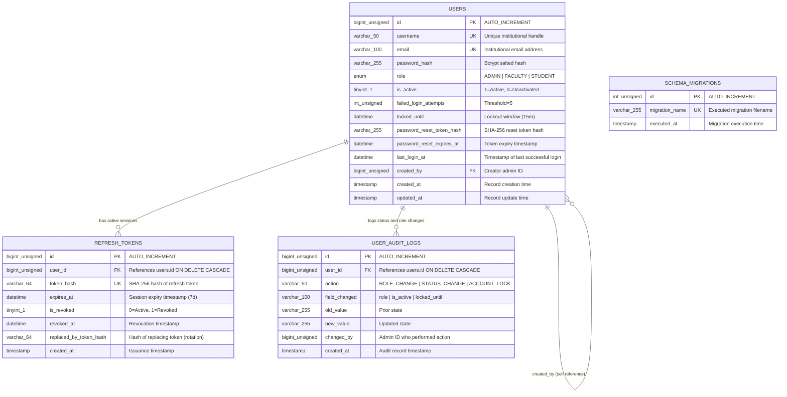

# College ERP — Authentication Module: Database Design

**Document Version:** 1.0.0  
**Target Milestone:** Stage 16 — Documentation & Final Review  
**Engine:** MySQL 8.0 (InnoDB)  
**Database Name:** `college_erp`  
**Collation:** `utf8mb4_unicode_ci`  

---

## 1. Overview

The College ERP Authentication database schema manages user accounts, cryptographic credential hashes, active refresh-token sessions, administrative audit history, and migration tracking.

### Core Architectural Principles:
1. **Zero Secret Exposure:** Raw passwords, plain reset tokens, and unhashed refresh tokens are never persisted. Passwords use salted bcrypt hashes; reset tokens and refresh tokens use SHA-256 hashes.
2. **Strict Foreign Key Constraints:** Cascade deletion and referential integrity protect session tables (`refresh_tokens`, `user_audit_logs`).
3. **Audit Immutability:** Sensitive state transitions (role updates, status modifications) are automatically recorded via database triggers without requiring application intervention.
4. **Separation of Administrative and Authentication Views:** Sanitized views expose account metadata to administrative interfaces while excluding sensitive cryptographic columns.

---

## 2. Entity-Relationship (ER) Diagram

---

## 3. Table Specifications

### 3.1 `users` Table
Primary entity representing authenticated individuals in the ERP.

| Column | Type | Nullable | Constraints & Description |
|---|---|---|---|
| `id` | `BIGINT UNSIGNED` | No | `PRIMARY KEY AUTO_INCREMENT` |
| `username` | `VARCHAR(50)` | No | `UNIQUE KEY uq_users_username`. Length 3–50 chars. |
| `email` | `VARCHAR(100)` | No | `UNIQUE KEY uq_users_email`. Institutional email. |
| `password_hash` | `VARCHAR(255)` | No | Salted bcrypt hash ($2a$/$2b$). Cost factor 10–14. |
| `role` | `ENUM('ADMIN','FACULTY','STUDENT')` | No | Institutional access tier. |
| `is_active` | `TINYINT(1)` | No | `DEFAULT 1`. 1 = active, 0 = deactivated. |
| `failed_login_attempts` | `INT UNSIGNED` | No | `DEFAULT 0`. Increments on bad password, resets on success. |
| `locked_until` | `DATETIME` | Yes | `DEFAULT NULL`. Account locked if `locked_until > NOW()`. |
| `password_reset_token_hash`| `VARCHAR(255)` | Yes | `DEFAULT NULL`. SHA-256 hash of active reset token. |
| `password_reset_expires_at`| `DATETIME` | Yes | `DEFAULT NULL`. Reset token expiration timestamp. |
| `last_login_at` | `DATETIME` | Yes | `DEFAULT NULL`. Updated upon successful login. |
| `created_by` | `BIGINT UNSIGNED` | Yes | `FOREIGN KEY fk_users_created_by REFERENCES users(id)`. |
| `created_at` | `TIMESTAMP` | No | `DEFAULT CURRENT_TIMESTAMP`. |
| `updated_at` | `TIMESTAMP` | No | `DEFAULT CURRENT_TIMESTAMP ON UPDATE CURRENT_TIMESTAMP`. |

### 3.2 `refresh_tokens` Table
Manages active, rotated, and revoked refresh token sessions.

| Column | Type | Nullable | Constraints & Description |
|---|---|---|---|
| `id` | `BIGINT UNSIGNED` | No | `PRIMARY KEY AUTO_INCREMENT` |
| `user_id` | `BIGINT UNSIGNED` | No | `FOREIGN KEY fk_refresh_tokens_user_id REFERENCES users(id) ON DELETE CASCADE`. |
| `token_hash` | `VARCHAR(64)` | No | `UNIQUE KEY uq_refresh_tokens_hash`. SHA-256 hash. |
| `expires_at` | `DATETIME` | No | Expiration timestamp (default 7 days). |
| `is_revoked` | `TINYINT(1)` | No | `DEFAULT 0`. 1 = revoked. |
| `revoked_at` | `DATETIME` | Yes | `DEFAULT NULL`. Timestamp of revocation. |
| `replaced_by_token_hash` | `VARCHAR(64)` | Yes | `DEFAULT NULL`. SHA-256 hash of replacement token. |
| `created_at` | `TIMESTAMP` | No | `DEFAULT CURRENT_TIMESTAMP`. |

### 3.3 `user_audit_logs` Table
Immutable audit trail capturing administrative modifications.

| Column | Type | Nullable | Constraints & Description |
|---|---|---|---|
| `id` | `BIGINT UNSIGNED` | No | `PRIMARY KEY AUTO_INCREMENT` |
| `user_id` | `BIGINT UNSIGNED` | No | `FOREIGN KEY fk_user_audit_logs_user_id REFERENCES users(id) ON DELETE CASCADE`. |
| `action` | `VARCHAR(50)` | No | E.g. `STATUS_CHANGE`, `ROLE_CHANGE`. |
| `field_changed` | `VARCHAR(100)` | No | Modified field name (`is_active`, `role`). |
| `old_value` | `VARCHAR(255)` | Yes | Prior value before update. |
| `new_value` | `VARCHAR(255)` | Yes | New value after update. |
| `changed_by` | `BIGINT UNSIGNED` | Yes | Administrator ID who initiated change. |
| `created_at` | `TIMESTAMP` | No | `DEFAULT CURRENT_TIMESTAMP`. |

---

## 4. Database Views

1. **`vw_user_summary`:**
   - **Purpose:** Supplies administrative user directories and paginated listings.
   - **Exposes:** `id`, `username`, `email`, `role`, `is_active`, `failed_login_attempts`, `locked_until`, `last_login_at`, `created_by`, `created_at`, `updated_at`.
   - **Security Invariant:** Strictly excludes `password_hash` and `password_reset_token_hash`.
2. **`vw_active_users`:**
   - **Purpose:** Read-only view returning only active accounts (`is_active = 1`).
   - **Security Invariant:** Strictly excludes all credential hashes.

---

## 5. Stored Procedures & Triggers

### 5.1 Stored Procedures
- **`sp_create_user(p_username, p_email, p_password_hash, p_role, p_created_by, OUT p_user_id)`:**
  Provisions a new user with input sanitization, canonical role enforcement, and uniqueness checks.
- **`sp_get_user_by_username(p_username)`:**
  Queries authentication credentials and status flags for backend authentication.
- **`sp_update_user_role(p_user_id, p_role)`:**
  Updates user role with normalization and audit trigger invocation.
- **`sp_update_user_status(p_user_id, p_is_active)`:**
  Activates or deactivates an account, clearing or recording state changes.

### 5.2 Triggers
- **`trg_users_after_update`:**
  Fires after updates on `users`. If `is_active` or `role` changes, an entry is automatically appended to `user_audit_logs` with `old_value` and `new_value`.

### 5.3 User-Defined Functions (UDFs)
- **`fn_normalize_role(p_role)`:** Trims and upper-cases input role string, validating against `ADMIN`, `FACULTY`, `STUDENT`.
- **`fn_format_role_label(p_role)`:** Translates canonical role ENUM into human-readable UI label.
- **`fn_get_account_status(p_is_active, p_locked_until, p_reference_time)`:** Evaluates whether account is `'ACTIVE'`, `'INACTIVE'`, or `'LOCKED'`.
