# Complete ERP ER diagram

This diagram consolidates every base table in `database/*/schema.sql` and its declared foreign-key relationships, including cross-module constraints in `constraints.sql`. PK = primary key; FK = foreign key; UK = unique key. The diagram omits views, procedures, functions, and triggers because they are not stored entities.

```mermaid
erDiagram
  DEPARTMENT {
    int department_id PK
    varchar department_code UK
    varchar department_name UK
    timestamp created_at
    timestamp updated_at
  }
  PROGRAM {
    int program_id PK
    varchar program_code UK
    varchar program_name
    int department_id FK
    tinyint duration_years
    timestamp created_at
    timestamp updated_at
  }
  ACADEMIC_YEAR {
    int academic_year_id PK
    varchar year_label UK
    date start_date
    date end_date
    timestamp created_at
  }
  SEMESTER {
    int semester_id PK
    int academic_year_id FK
    enum term
    date start_date
    date end_date
    timestamp created_at
  }
  STUDENT {
    int student_id PK
    varchar enrollment_no UK
    varchar first_name
    varchar last_name
    varchar email UK
    int program_id FK
    enum status
    timestamp created_at
    timestamp updated_at
  }
  FACULTY {
    int faculty_id PK
    varchar employee_code UK
    varchar first_name
    varchar last_name
    varchar email UK
    int department_id FK
    enum status
    timestamp created_at
    timestamp updated_at
  }
  ROLE {
    int role_id PK
    varchar role_name UK
    timestamp created_at
  }
  APP_USER {
    int user_id PK
    varchar username UK
    varchar email UK
    varchar password_hash
    int role_id FK
    int student_id FK,UK
    int faculty_id FK,UK
    boolean is_active
    tinyint failed_attempts
    datetime locked_until
    datetime last_login_at
    timestamp created_at
    timestamp updated_at
  }
  REFRESH_TOKENS {
    bigint refresh_token_id PK
    int user_id FK
    char token_hash UK
    datetime expires_at
    boolean is_revoked
    datetime revoked_at
    char replaced_by_token_hash
    timestamp created_at
  }
  PASSWORD_RESET_TOKENS {
    bigint reset_token_id PK
    int user_id FK
    char token_hash UK
    datetime expires_at
    datetime consumed_at
    timestamp created_at
  }
  LOGIN_AUDIT {
    int login_audit_id PK
    int user_id FK
    varchar username_attempted
    boolean success
    timestamp attempted_at
    varchar ip_address
  }
  ROLE_CHANGE_AUDIT {
    int audit_id PK
    int user_id FK
    int old_role_id FK
    int new_role_id FK
    timestamp changed_at
  }
  STUDENT_PROFILE {
    int student_id PK,FK
    date date_of_birth
    varchar phone
    varchar address
    smallint admission_year
    timestamp created_at
    timestamp updated_at
  }
  GUARDIAN {
    int guardian_id PK
    int student_id FK
    varchar name
    enum relation
    varchar phone
    varchar email
    timestamp created_at
  }
  ADMISSION {
    int admission_id PK
    int student_id FK,UK
    date admission_date
    enum admission_type
    decimal merit_score
    timestamp created_at
  }
  STUDENT_PROFILE_AUDIT {
    int audit_id PK
    int student_id
    varchar field_name
    varchar old_value
    varchar new_value
    timestamp changed_at
  }
  COURSE {
    int course_id PK
    varchar course_code UK
    varchar course_name
    tinyint credits
    int department_id FK
    tinyint semester_no
    timestamp created_at
    timestamp updated_at
  }
  COURSE_OFFERING {
    int offering_id PK
    int course_id FK
    int semester_id FK
    smallint capacity
    timestamp created_at
  }
  ENROLLMENT {
    int enrollment_id PK
    int student_id FK
    int offering_id FK
    date enrolled_on
    enum status
    timestamp created_at
    timestamp updated_at
  }
  ATTENDANCE {
    int attendance_id PK
    int enrollment_id FK
    date class_date
    enum status
    timestamp created_at
  }
  DESIGNATION {
    int designation_id PK
    varchar designation_name UK
    tinyint level_no
    timestamp created_at
  }
  FACULTY_PROFILE {
    int faculty_id PK,FK
    int designation_id FK
    date date_of_joining
    varchar phone
    varchar office_room
    varchar specialization
    timestamp created_at
    timestamp updated_at
  }
  FACULTY_QUALIFICATION {
    int qualification_id PK
    int faculty_id FK
    varchar degree
    varchar institution
    smallint year_passed
    timestamp created_at
  }
  FACULTY_DESIGNATION_HISTORY {
    int history_id PK
    int faculty_id FK
    int old_designation_id FK
    int new_designation_id FK
    date changed_on
  }
  COURSE_ALLOCATION {
    int allocation_id PK
    int faculty_id FK
    int offering_id FK
    tinyint hours_per_week
    timestamp created_at
    timestamp updated_at
  }
  LEAVE_TYPE {
    int leave_type_id PK
    varchar type_name UK
    decimal annual_days
  }
  LEAVE_BALANCE {
    int leave_balance_id PK
    int faculty_id FK
    int leave_type_id FK
    smallint balance_year
    decimal days_remaining
  }
  LEAVE_REQUEST {
    int leave_request_id PK
    int faculty_id FK
    int leave_type_id FK
    date start_date
    date end_date
    decimal days_requested
    enum status
    timestamp requested_at
    datetime decided_at
  }
  SALARY_STRUCTURE {
    int salary_structure_id PK
    int faculty_id FK
    decimal basic_pay
    date effective_from
    date effective_to
  }
  SALARY_CHANGE_LOG {
    int salary_change_id PK
    int salary_structure_id FK
    decimal old_basic_pay
    decimal new_basic_pay
    timestamp changed_at
  }
  PAYROLL {
    int payroll_id PK
    int faculty_id FK
    date period_start
    date period_end
    decimal basic_pay
    decimal gross_pay
    decimal pf_amount
    decimal professional_tax
    decimal lop_amount
    decimal net_pay
    timestamp generated_at
  }
  FEE_STRUCTURE {
    int fee_structure_id PK
    int program_id FK
    int academic_year_id FK
    varchar fee_name
    decimal amount
    date due_date
    decimal late_fee_rate
  }
  FEE_STRUCTURE_AUDIT {
    int fee_audit_id PK
    int fee_structure_id FK
    decimal old_amount
    decimal new_amount
    timestamp changed_at
  }
  FEE_PAYMENT {
    int fee_payment_id PK
    int student_id FK
    int fee_structure_id FK
    datetime paid_at
    decimal base_amount
    decimal late_fee
    decimal total_amount
    enum payment_method
  }
  RECEIPT {
    int receipt_id PK
    int fee_payment_id FK,UK
    varchar receipt_no UK
    timestamp issued_at
  }
  HOSTEL {
    int hostel_id PK
    varchar hostel_name UK
    varchar address
  }
  HOSTEL_ROOM {
    int hostel_room_id PK
    int hostel_id FK
    varchar room_no
    tinyint capacity
  }
  HOSTEL_ALLOCATION {
    int hostel_allocation_id PK
    int hostel_room_id FK
    int student_id FK
    date allocated_on
    enum status
  }
  NOTICE {
    int notice_id PK
    varchar title
    text body
    enum audience
    datetime published_at
    datetime expires_at
    int created_by
  }
  EXAM {
    int exam_id PK
    int offering_id FK
    varchar exam_name
    date exam_date
    decimal max_marks
    boolean registration_open
    boolean results_published
  }
  EXAM_HALL {
    int exam_hall_id PK
    varchar hall_name UK
    smallint capacity
  }
  EXAM_REGISTRATION {
    int exam_registration_id PK
    int exam_id FK
    int enrollment_id FK
    int exam_hall_id FK
    timestamp registered_at
  }
  GRADE_SCALE {
    int grade_scale_id PK
    varchar grade UK
    decimal minimum_percent
    decimal grade_point
  }
  MARKS {
    int marks_id PK
    int exam_registration_id FK,UK
    decimal marks_obtained
    int grade_scale_id FK
    int entered_by
    timestamp entered_at
  }
  MARKS_AUDIT {
    int marks_audit_id PK
    int marks_id FK
    decimal old_marks
    decimal new_marks
    timestamp changed_at
  }
  RESULT_SUMMARY {
    int result_summary_id PK
    int student_id FK
    int semester_id FK
    decimal sgpa
    decimal cgpa
    timestamp published_at
  }
  REVALUATION_REQUEST {
    int revaluation_request_id PK
    int marks_id FK
    varchar reason
    enum status
    timestamp requested_at
  }

  DEPARTMENT ||--o{ PROGRAM : contains
  DEPARTMENT ||--o{ FACULTY : employs
  DEPARTMENT ||--o{ COURSE : owns
  PROGRAM ||--o{ STUDENT : admits
  ACADEMIC_YEAR ||--o{ SEMESTER : groups
  ACADEMIC_YEAR ||--o{ FEE_STRUCTURE : applies
  PROGRAM ||--o{ FEE_STRUCTURE : charged
  STUDENT ||--o| APP_USER : account
  FACULTY ||--o| APP_USER : account
  ROLE ||--o{ APP_USER : grants
  APP_USER ||--o{ REFRESH_TOKENS : holds
  APP_USER ||--o{ PASSWORD_RESET_TOKENS : resets
  APP_USER o|--o{ LOGIN_AUDIT : attempts
  APP_USER ||--o{ ROLE_CHANGE_AUDIT : role_changes
  ROLE ||--o{ ROLE_CHANGE_AUDIT : old_role
  ROLE ||--o{ ROLE_CHANGE_AUDIT : new_role
  STUDENT ||--o| STUDENT_PROFILE : profile
  STUDENT ||--o{ GUARDIAN : has
  STUDENT ||--o| ADMISSION : admitted
  COURSE ||--o{ COURSE_OFFERING : offered_as
  SEMESTER ||--o{ COURSE_OFFERING : schedules
  STUDENT ||--o{ ENROLLMENT : enrolls
  COURSE_OFFERING ||--o{ ENROLLMENT : includes
  ENROLLMENT ||--o{ ATTENDANCE : records
  DESIGNATION ||--o{ FACULTY_PROFILE : assigned
  FACULTY ||--o| FACULTY_PROFILE : profile
  FACULTY ||--o{ FACULTY_QUALIFICATION : earns
  FACULTY ||--o{ FACULTY_DESIGNATION_HISTORY : history
  DESIGNATION o|--o{ FACULTY_DESIGNATION_HISTORY : previous_rank
  DESIGNATION ||--o{ FACULTY_DESIGNATION_HISTORY : next_rank
  FACULTY ||--o{ COURSE_ALLOCATION : teaches
  COURSE_OFFERING ||--o{ COURSE_ALLOCATION : assigned
  FACULTY ||--o{ LEAVE_BALANCE : accrues
  LEAVE_TYPE ||--o{ LEAVE_BALANCE : tracks
  FACULTY ||--o{ LEAVE_REQUEST : requests
  LEAVE_TYPE ||--o{ LEAVE_REQUEST : classifies
  FACULTY ||--o{ SALARY_STRUCTURE : has
  SALARY_STRUCTURE ||--o{ SALARY_CHANGE_LOG : audited
  FACULTY ||--o{ PAYROLL : receives
  FEE_STRUCTURE ||--o{ FEE_STRUCTURE_AUDIT : changes
  FEE_STRUCTURE ||--o{ FEE_PAYMENT : paid_against
  STUDENT ||--o{ FEE_PAYMENT : pays
  FEE_PAYMENT ||--o| RECEIPT : receipt
  HOSTEL ||--o{ HOSTEL_ROOM : contains
  HOSTEL_ROOM ||--o{ HOSTEL_ALLOCATION : assigned
  STUDENT ||--o{ HOSTEL_ALLOCATION : resides
  COURSE_OFFERING ||--o{ EXAM : assessed_by
  EXAM ||--o{ EXAM_REGISTRATION : registers
  ENROLLMENT ||--o{ EXAM_REGISTRATION : eligible
  EXAM_HALL o|--o{ EXAM_REGISTRATION : hosts
  EXAM_REGISTRATION ||--o| MARKS : receives
  GRADE_SCALE o|--o{ MARKS : grades
  MARKS ||--o{ MARKS_AUDIT : changes
  MARKS ||--o{ REVALUATION_REQUEST : challenged
  STUDENT ||--o{ RESULT_SUMMARY : earns
  SEMESTER ||--o{ RESULT_SUMMARY : summarizes
```

## Schema notes

- The single-column unique constraints also determine cardinality: course + semester uniquely identifies an offering; student + offering an enrollment; faculty + offering a course allocation; student + fee structure a fee payment; and student + semester a result summary.
- `STUDENT_PROFILE_AUDIT.student_id`, `NOTICE.created_by`, `MARKS.entered_by`, and `REFRESH_TOKENS.replaced_by_token_hash` are not declared as foreign keys in the SQL. They are shown as attributes without relationship lines to reflect the implemented schema.
- The ERD treats `APP_USER.student_id` and `APP_USER.faculty_id` as optional unique links. A check constraint prevents both being set together; the database does not enforce that one must be set.
