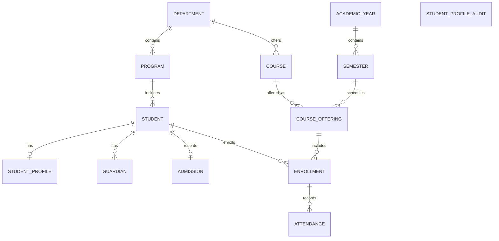

# Student Management overview ERD

This entity-only overview presents the Student Management records and shared academic structure. It uses the same declared foreign-key relationships as the detailed ERD. Crow's-foot markers show minimum and maximum cardinality.

Exports: [SVG](exports/student-management-overview.svg) · [PNG](exports/student-management-overview.png)

`STUDENT_PROFILE_AUDIT` is shown as an isolated entity because its `student_id` column has no declared foreign key to `STUDENT`. Its audit association is not enforced by the database.
