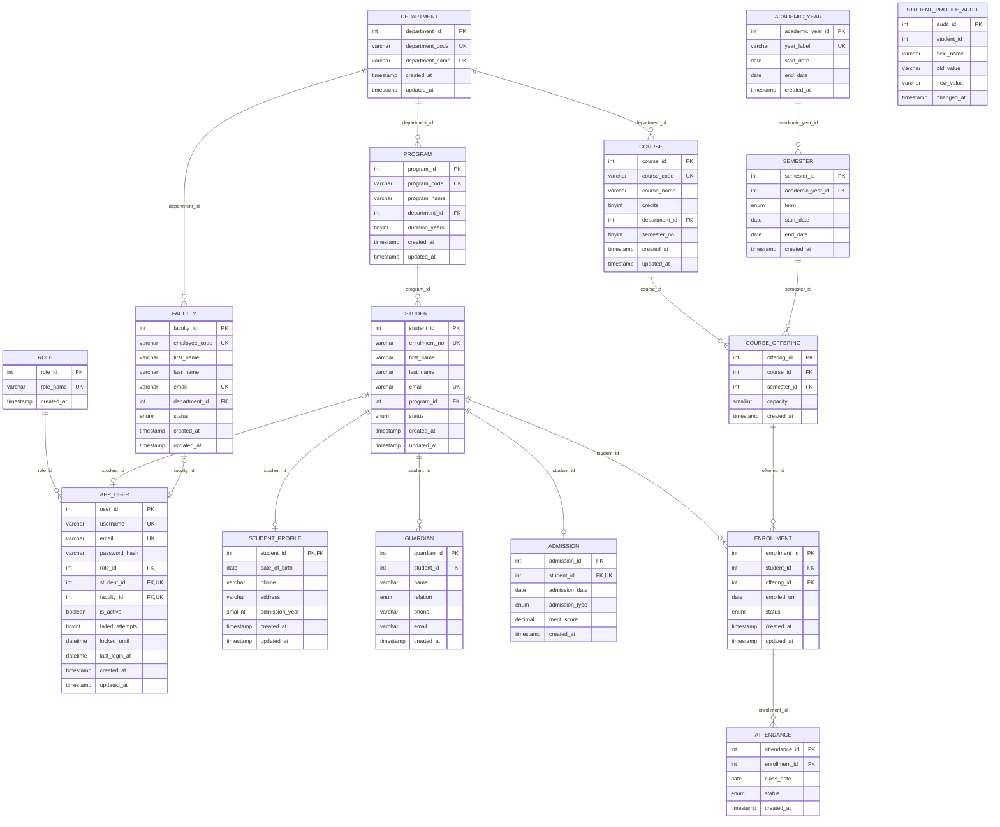

# Student Management ER diagram

This standalone diagram covers the Student Management tables and the shared identity, academic-calendar, and department entities required to explain their declared foreign keys. PK = primary key; FK = foreign key; UK = unique key. Attributes retain the SQL column names; nullability and other constraints are summarized below where they affect cardinality.

Exports: [SVG](exports/student-management.svg) · [PNG](exports/student-management.png)

For the entity-only view, see [student-management-overview.md](student-management-overview.md).

## Relationship and constraint notes

- Each FK column on a child row is `NOT NULL`, so each child requires exactly one referenced parent. Parent rows may have no children unless uniqueness changes that cardinality.
- `STUDENT_PROFILE.student_id` is both its PK and FK; a profile requires one student, while a student may have zero or one profile in the schema.
- `ADMISSION.student_id` is `NOT NULL` and unique, so each admission belongs to exactly one student and a student has zero or one admission.
- `APP_USER.student_id` and `APP_USER.faculty_id` are nullable, unique FKs. A user may be unlinked or linked to one student or faculty member; a student/faculty member may have at most one linked user. A check constraint prohibits setting both links on the same user. Auth triggers further require the matching link for STUDENT and FACULTY roles and forbid either link for ADMIN; the schema does not enforce a link for every role value.
- `COURSE_OFFERING` has a unique `(course_id, semester_id)` pair, and `ENROLLMENT` has a unique `(student_id, offering_id)` pair. Those composite constraints do not change the one-to-many cardinalities shown.
- `ATTENDANCE` has a unique `(enrollment_id, class_date)` pair, allowing at most one attendance row per enrollment per date.
- `STUDENT_PROFILE_AUDIT.student_id` is shown as an ordinary attribute only. The update trigger writes this value, but `database/02_student/schema.sql` declares no FK for it, so the diagram intentionally has no relationship line to `STUDENT`.
- The shared entities shown are limited to dependencies of Student Management or its identity links. Views, procedures, functions, triggers, seed rows, and authentication token/audit tables are not entities in this module diagram.
