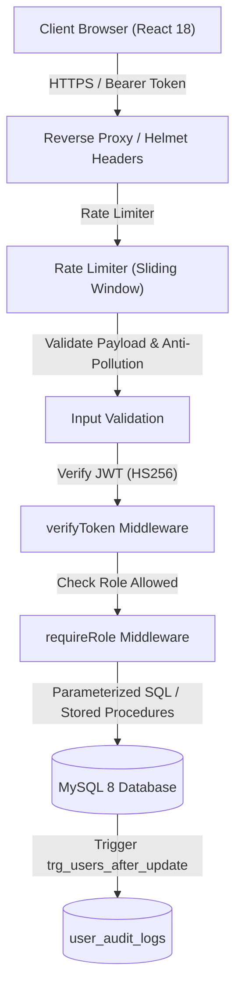

# College ERP — Authentication Module: Security Policy & Threat Model

**Document Version:** 1.0.0  
**Target Milestone:** Stage 16 — Documentation & Final Review  
**Status:** Active Security Specification  

---

## 1. Security Architecture & Threat Model

The College ERP Authentication Module operates under a strict Zero-Trust principle for external clients, maintaining complete server-side authorization enforcement and immutable auditing.

---

## 2. OWASP Top 10 Compliance Review

| OWASP Risk Category | Applied Mitigation in College ERP Auth Module | Verification Status |
|---|---|---|
| **A01: Broken Access Control** | Server-side `requireRole` middleware with fail-fast registration; UI route guards in React (`ProtectedRoute`); admin self-demotion and self-deactivation protection; last active admin defense. | **VERIFIED ✅** (49 integration & RBAC tests) |
| **A02: Cryptographic Failures** | Passwords hashed using salted `bcryptjs` with cost factor 10–14 (production default 12); refresh tokens and password reset tokens stored strictly as SHA-256 hashes; JWTs signed using HS256 with 32+ char production secret; no PII in token claims. | **VERIFIED ✅** |
| **A03: Injection** | 100% of database queries use parameterized SQL (`?`) or MySQL stored procedures (`CALL sp_*`); strict bounds validation on pagination and numeric IDs. | **VERIFIED ✅** |
| **A04: Insecure Design** | Public registration is disabled; only authenticated administrators can provision accounts; single-use arithmetic CAPTCHA required before credential checking; account lockout after 5 consecutive failures; identical anti-enumeration generic responses for forgot-password. | **VERIFIED ✅** |
| **A05: Security Misconfiguration** | Helmet security headers enforced (`X-Content-Type-Options: nosniff`, `X-Frame-Options: SAMEORIGIN`, `HSTS`); `X-Powered-By` framework header disabled; centralized error handler suppresses internal errors, stack traces, and database syntax details in production. | **VERIFIED ✅** |
| **A06: Vulnerable and Outdated Components** | Minimal dependency tree pinned in `package.json`; dev-only tooling (`nodemon`, `jest`) excluded from production builds. | **VERIFIED ✅** |
| **A07: Identification and Authentication Failures** | Timing-attack mitigation via dummy bcrypt execution when user is not found; single-use atomic refresh token rotation using row-level locking (`SELECT ... FOR UPDATE`); replay attack detection with immediate session invalidation; 15-minute password reset expiry. | **VERIFIED ✅** |
| **A08: Software and Data Integrity Failures** | Strict mass-assignment defense via `checkUnexpectedFields`; prototype pollution keys (`__proto__`, `constructor`, `prototype`) explicitly blocked on all payloads. | **VERIFIED ✅** |
| **A09: Security Logging and Monitoring Failures** | Structured logging via `logger.js`; zero sensitive credentials (passwords, tokens, hashes) ever logged; database triggers automatically audit status and role changes into `user_audit_logs`. | **VERIFIED ✅** |
| **A10: Server-Side Request Forgery (SSRF)** | The authentication module does not make arbitrary outbound HTTP requests to user-supplied URLs. | **VERIFIED ✅** |

---

## 3. Account Provisioning & Registration Policy

### 3.1 Closed Registration Model
Public signup and self-registration are intentionally **DISABLED**:
- No endpoint exists for public registration (`POST /api/v1/auth/register` does not exist).
- The React login page explicitly displays a prominent notification: `"Notice: Public self-registration is disabled. Institutional accounts are provisioned exclusively by authorized campus administrators."`
- Accounts can only be provisioned by authenticated users holding the `ADMIN` role via `POST /api/v1/admin/users`.
- Role assignment is constrained to authorized values (`FACULTY` and `STUDENT`) to prevent privilege escalation.

---

## 4. Known Security & Operational Limitations

1. **Process-Local Rate Limiting:**
   - The rate limiters (`createRateLimiter`) currently track client IP request windows in an in-memory JavaScript `Map`. While suitable for single-node development and standalone servers, horizontal scaling across multiple load-balanced Node processes requires replacing the in-memory store with a shared Redis cache.
2. **Stateless Access Token Natural Expiration Window:**
   - When an administrator deactivates an account (`PATCH /admin/users/:id/status`), all active refresh-token sessions are immediately revoked in MySQL, preventing any new tokens from being issued.
   - However, existing stateless JWT access tokens remain cryptographically valid until their natural expiry (default: 8 hours). In high-assurance production environments, an in-memory token revocation blocklist or a shorter access token lifetime (e.g. 15 minutes) should be configured.
3. **Frontend Token Storage (`localStorage`):**
   - The React client stores the JWT access token and refresh token in browser `localStorage`. This eliminates Cross-Site Request Forgery (CSRF) vulnerabilities by design, as Bearer tokens are never automatically attached by browsers.
   - However, tokens stored in `localStorage` are vulnerable if a Cross-Site Scripting (XSS) vulnerability exists. Mitigations include strict Content Security Policies (CSP) and sanitization. For production hardening, migrating refresh tokens to `HttpOnly`, `SameSite=Strict`, `Secure` cookies can be considered.
4. **SMTP Email Delivery:**
   - Password reset tokens are generated and stored strictly as SHA-256 hashes in MySQL. Real password reset emails are not dispatched because SMTP credentials have not been configured in `backend/.env`. Password reset tokens are retrieved only via dev hooks during testing.
